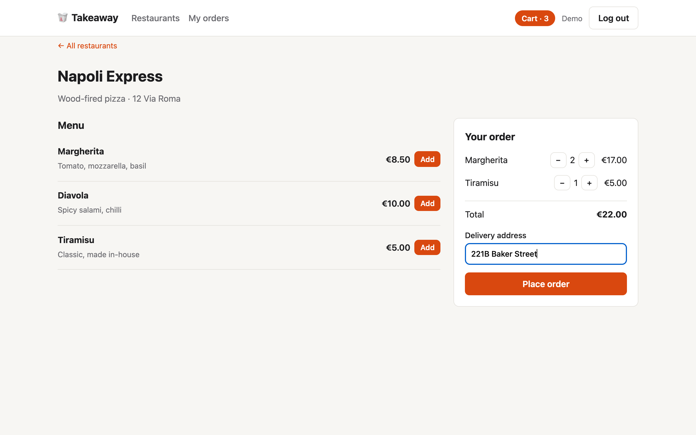
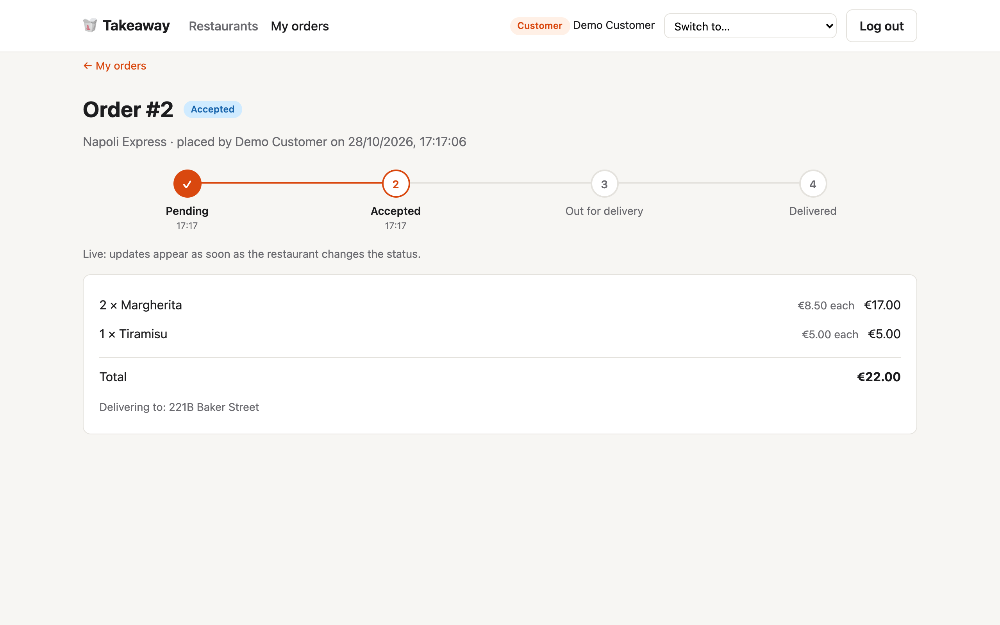
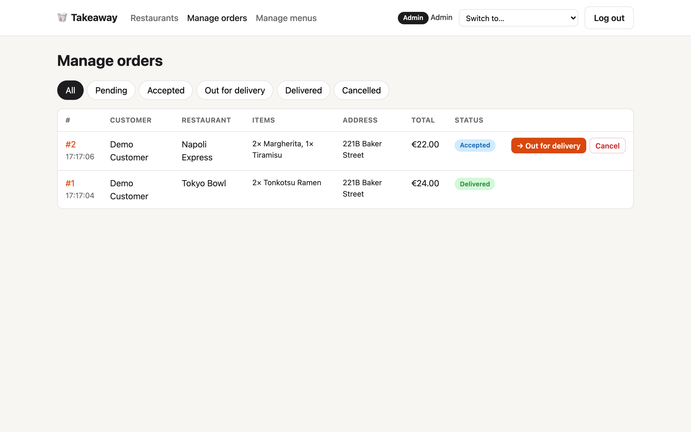
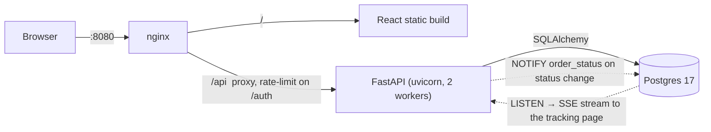

# Takeaway Platform

A small takeaway platform: customers browse restaurants and menus, place orders and
track their status; staff (admins) manage menus and move orders through their lifecycle.

| Path      | What                                                              |
|-----------|-------------------------------------------------------------------|
| `api/`    | FastAPI + SQLAlchemy + Alembic backend ([details](api/README.md)) |
| `web/`    | React + TypeScript UI ([details](web/README.md))                  |
| `nginx/`  | Reverse proxy config                                              |

| Order with a live cart | Live order tracking | Staff order board |
|---|---|---|
|  |  |  |

## Review in 2 minutes

```bash
docker compose up --build        # no .env needed; migrations + demo data run on start
```

1. Open **http://localhost:8080**: you're signed in as the demo **Customer** (badge, top right).
   Add a few items and place an order.
2. Open a **private window** (it has its own session), choose **Switch to… → Admin (Admin)**, then
   **Manage orders**.
3. Advance the order. The customer's tracking page updates **instantly** (Server-Sent Events),
   with a timestamp per step.
4. API docs with "Authorize": **http://localhost:8080/api/docs**.

Seeded accounts: `customer@takeaway.dev` / `customer1234` and `admin@takeaway.dev` /
`admin1234`. Sign up to create more customers.

Tests (needs the compose `db` running; uses a separate `takeaway_test` database):

```bash
cd api && uv sync && uv run pytest
```

## Architecture



On start the API container runs Alembic migrations and an idempotent seed (admin user +
a demo customer + two demo restaurants), then reports healthy; nginx waits for that.

## API overview

All routes are under `/api/v1`. Auth is JWT bearer; get a token from `POST /auth/login`
(OAuth2 password form: `username` = email). The "Authorize" button in the docs works too.

| Method | Path                                   | Who      | Purpose                         |
|--------|----------------------------------------|----------|---------------------------------|
| POST   | `/auth/register`                       | public   | Create a customer account       |
| POST   | `/auth/login`                          | public   | Get an access token             |
| GET    | `/auth/me`                             | user     | Current user                    |
| GET    | `/restaurants`                         | public   | List active restaurants         |
| GET    | `/restaurants/{id}`                    | public   | Restaurant details              |
| GET    | `/restaurants/{id}/menu`               | public   | Menu                            |
| POST   | `/restaurants`                         | admin    | Create restaurant               |
| PATCH  | `/restaurants/{id}`                    | admin    | Update / deactivate restaurant  |
| POST   | `/restaurants/{id}/menu`               | admin    | Add menu item                   |
| PATCH  | `/restaurants/{id}/menu/{item_id}`     | admin    | Update menu item                |
| DELETE | `/restaurants/{id}/menu/{item_id}`     | admin    | Remove menu item                |
| POST   | `/orders`                              | user     | Place an order (`Idempotency-Key` optional; address defaults to the saved one) |
| GET    | `/orders?status=`                      | user     | Own orders (admins: all)        |
| GET    | `/orders/{id}`                         | user     | Order with its status history   |
| GET    | `/orders/{id}/stream`                  | user     | Live status (Server-Sent Events)|
| POST   | `/orders/{id}/cancel`                  | user     | Cancel own order while pending  |
| PATCH  | `/orders/{id}/status`                  | admin    | Advance order status            |

### Order lifecycle

```
pending ──► accepted ──► out_for_delivery ──► delivered
   │            │
   └────────────┴──► cancelled
```

Invalid transitions return `409 Conflict`. Status updates lock the order row
(`SELECT … FOR UPDATE`) so concurrent updates can't skip a step. Every change is appended to
`order_status_events` (audit trail + per-step timestamps) and announced with Postgres
`NOTIFY`, which the `/stream` endpoint relays to the customer as Server-Sent Events.

## Design notes

- **Prices are snapshotted** on order items (name + unit price), so editing or deleting a
  menu item never rewrites order history. The total is computed server-side.
- **Restaurants are deactivated, not deleted**, because orders reference them.
- **Customers get 404 for other people's orders** rather than 403, so order IDs don't leak.
- **Money is `Decimal`** end to end and serialised as a string (`"17.00"`) to avoid float rounding.
- Admins are created by the seed script from env vars; public registration only creates customers.
- **Pessimistic locking for status changes** (`SELECT … FOR UPDATE`) rather than optimistic
  versioning: contention on a single order is rare and short, and it keeps the code obvious.
  A test holds the lock from a second transaction to prove updates wait and re-check.
- **Tests run on Postgres through the real Alembic migrations**, so locks, enums and `Numeric`
  behave exactly as in production, and migrations are exercised on every run.
- **Public endpoints accept an optional token**: anonymous users only see active restaurants,
  admins see inactive ones too (so they can reactivate them).
- **Ordering rules**: one active (not delivered/cancelled) order per restaurant per customer,
  and at most `MAX_ORDERS_PER_CUSTOMER` (10) non-cancelled orders. Both are checked while
  holding a lock on the customer's row, so two simultaneous checkouts can't slip past them.
- **Saved address**: the last delivery address is stored on the user, pre-fills checkout, and
  is used when an order omits it; editing it at checkout updates the saved one.
- **Live tracking uses SSE + Postgres `LISTEN/NOTIFY`** rather than WebSockets or Redis:
  updates are one-way (server → customer), SSE is plain HTTP through nginx, and NOTIFY is
  transactional (sent only on commit) and reaches every uvicorn worker with no extra service.
- **Idempotent order placement**: an optional `Idempotency-Key` header (unique per customer)
  makes retries and double clicks return the original order; the web UI sends one per checkout.
- **Demo account switcher** (local only): the app starts signed in as the seeded customer and a
  header dropdown lists every account (new sign-ups included) to switch between without typing
  passwords. It's backed by `GET /auth/demo-accounts` and `POST /auth/demo-login/{user_id}`,
  which return 404 when `ENVIRONMENT=production`; sign-up and normal login work as usual.
- **Hardening kept deliberately small**: login/register are rate-limited in nginx, Postgres is
  bound to localhost, the health check hits the DB, and `ENVIRONMENT=production` refuses to
  start with the default JWT secret or admin password.

## Trade-offs & what I'd do next

- **One DB connection per open stream** (each LISTENs itself). Fine here; at scale, one
  listener per worker would fan notifications out to an in-memory set of subscribers.
- **Idempotency keys don't check the body**: reusing a key with a different cart returns the
  first order. Production would store a request hash and reject mismatches with 422.
- **The staff order board polls** every 10 s; it could subscribe to the same stream.
- **Migrations run on container start**, fine for one instance; with several replicas they'd
  move to a one-off deploy job.
- **Staff are global admins**; a real platform would scope staff to their restaurants.
- **Auth**: short-lived access tokens only — no refresh tokens or revocation. The web UI keeps
  the token in `localStorage`; an httpOnly cookie would be safer against XSS.
- **Services raise `HTTPException`** directly; with more business logic I'd use domain
  exceptions mapped to HTTP in one place.
- No CI pipeline or structured logging yet (uvicorn access logs only); reviewers run it locally.
