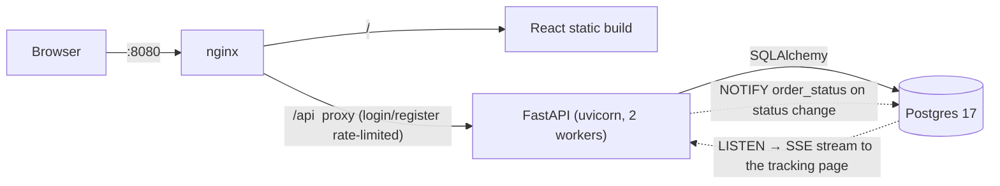

# Takeaway Platform

A small takeaway platform: customers browse restaurants and menus, place orders and
track their status live; staff (admins) manage menus and move orders through their lifecycle.

| Path      | What                                                              |
|-----------|-------------------------------------------------------------------|
| `api/`    | FastAPI + SQLAlchemy + Alembic backend ([details](api/README.md)) |
| `web/`    | React + TypeScript UI ([details](web/README.md))                  |
| `nginx/`  | Reverse proxy config                                              |

| Order with a live cart | Live order tracking | Staff order board |
|---|---|---|
|  |  |  |

## Review in 2 minutes

```bash
docker compose up --build        # no .env needed; migrations + demo data run on start
```

1. Open **http://localhost:8080**: you're signed in as the demo **Customer** (badge, top right).
   Add a few items and place an order.
2. Open a **private window** (it has its own session), choose **Switch to… → Admin (Admin)**, then
   **Manage orders**.
3. Advance the order. The customer's tracking page updates **instantly** (Server-Sent Events),
   with a timestamp per step.
4. API docs with "Authorize": **http://localhost:8080/api/docs**.

Seeded accounts: `customer@takeaway.dev` / `customer1234` and `admin@takeaway.dev` /
`admin1234`. Sign up to create more customers; the **Switch to…** dropdown lists every account.

Tests (need the compose `db` running; they use a separate `takeaway_test` database, so run one
test session at a time):

```bash
cd api && uv sync && uv run pytest
```

## Architecture



On start the API container runs Alembic migrations and an idempotent seed (admin, a demo
customer and two demo restaurants), then reports healthy; nginx waits for that.

## API overview

All routes are under `/api/v1`. Auth is JWT bearer; get a token from `POST /auth/login`
(OAuth2 password form: `username` = email). The "Authorize" button in the docs works too.

| Method | Path                               | Who      | Purpose                                         |
|--------|------------------------------------|----------|-------------------------------------------------|
| POST   | `/auth/register`                   | public   | Create a customer account                       |
| POST   | `/auth/login`                      | public   | Get an access token                             |
| GET    | `/auth/me`                         | user     | Current user (incl. saved address)              |
| GET    | `/auth/demo-accounts`              | demo     | All accounts, for the UI's account switcher     |
| POST   | `/auth/demo-login/{user_id}`       | demo     | Token for any account, no password              |
| GET    | `/restaurants`                     | public   | Active restaurants (admins also see inactive)   |
| GET    | `/restaurants/{id}`                | public   | Restaurant details (404 if inactive, for non-admins) |
| GET    | `/restaurants/{id}/menu`           | public   | Menu                                            |
| POST   | `/restaurants`                     | admin    | Create restaurant                               |
| PATCH  | `/restaurants/{id}`                | admin    | Update; `is_active: false` deactivates          |
| POST   | `/restaurants/{id}/menu`           | admin    | Add menu item                                   |
| PATCH  | `/restaurants/{id}/menu/{item_id}` | admin    | Update menu item                                |
| DELETE | `/restaurants/{id}/menu/{item_id}` | admin    | Remove menu item                                |
| POST   | `/orders`                          | customer | Place an order (`Idempotency-Key` header optional) |
| GET    | `/orders?status=`                  | user     | Own orders (admins: all)                        |
| GET    | `/orders/{id}`                     | user     | Order with items and status history             |
| GET    | `/orders/{id}/stream`              | user     | Live status (Server-Sent Events)                |
| POST   | `/orders/{id}/cancel`              | user     | Cancel own order while pending                  |
| PATCH  | `/orders/{id}/status`              | admin    | Advance or cancel an order                      |

"demo" routes exist only with `DEMO_LOGINS=true` (set by docker-compose; 404 otherwise, and
refused in production). Admins can't place orders (403).

### Order lifecycle

```
pending ──► accepted ──► out_for_delivery ──► delivered
   │            │
   └────────────┴──► cancelled
```

Invalid transitions return `409 Conflict`. Every change is appended to `order_status_events`
(audit trail + per-step timestamps) and announced with Postgres `NOTIFY`, which the `/stream`
endpoint relays to the customer as Server-Sent Events.

## Business rules

| Rule | Where it's enforced |
|---|---|
| Up to 10 of each menu item per order, each item on one line, up to 50 lines | Request schema (422) |
| One active (not delivered/cancelled) order per restaurant per customer | Order service (409, names the order) |
| At most `MAX_ORDERS_PER_CUSTOMER` (10) orders per customer, cancelled ones not counted | Order service (409) |
| Unavailable items, items from another restaurant, inactive restaurants can't be ordered | Order service (409 / 422 / 404) |
| The delivery address is saved on the customer and pre-fills (or, if omitted, fills) the next order | Order service + checkout UI |
| Customers cancel only while pending; staff can cancel pending or accepted orders | Status rules (409) |
| Deactivating a restaurant cancels its pending and accepted orders; ones out for delivery complete | Restaurant update (same transaction) |
| Staff accounts don't place orders | `CustomerUser` dependency (403) |

The web UI mirrors these (quantity buttons stop at 10, an active order is shown instead of
checkout, staff get no cart), and keeps the cart honest: it re-syncs with the live menu
(removed/unavailable items dropped, prices refreshed), is cleared when its restaurant goes
away, and belongs to the account that filled it.

## Consistency under concurrency

Row locks are taken in one order (customer → restaurant → menu items / orders), so they can't
deadlock:

- **Status changes** lock the order (`SELECT … FOR UPDATE`): two staff can't both advance it,
  and a customer's cancel can't race an accept. A test holds the lock from another transaction
  to prove an update waits and then re-checks.
- **Checkout** locks the customer row, so simultaneous checkouts (or retries with the same
  `Idempotency-Key`) run one after another: limits can't be slipped past, and a retry returns
  the original order. It also takes *shared* locks on the restaurant and the ordered menu items,
  so they can't be deactivated or deleted mid-checkout, while checkouts don't block each other.
- **Deactivating a restaurant** takes an exclusive lock on it, then cancels its open orders in
  the same transaction.

## Design notes

- **Prices are snapshotted** on order items (name + unit price), so editing or deleting a
  menu item never rewrites order history. The total is computed server-side.
- **Money is `Decimal`** end to end and serialised as a string (`"17.00"`) to avoid float rounding.
- **Restaurants are deactivated, not deleted**, because orders reference them; orders keep
  showing the restaurant's name.
- **Customers get 404 for other people's orders** rather than 403, so order IDs don't leak.
- **Public read endpoints, authenticated writes.** Browsing needs no account (like most
  takeaway apps); an optional token lets admins see inactive restaurants.
- **Live tracking uses SSE + Postgres `LISTEN/NOTIFY`** rather than WebSockets or Redis:
  updates are one-way, SSE is plain HTTP through nginx, and NOTIFY is transactional (sent only
  on commit) and reaches every uvicorn worker with no extra service.
- **Idempotent order placement**: an optional `Idempotency-Key` header (unique per customer)
  makes retries and double clicks return the original order; the UI sends one per checkout.
- **Tests run on Postgres through the real Alembic migrations**, so locks, enums and `Numeric`
  behave as in production and migrations are exercised on every run.
- **Small, explicit hardening**: login/register rate-limited in nginx, Postgres bound to
  localhost, a DB-checking health probe, and `ENVIRONMENT=production` refuses to start with
  default secrets or with `DEMO_LOGINS` on.

## Configuration

Every variable has a working default in `docker-compose.yml`; see `.env.example`.

| Variable | Default | Purpose |
|---|---|---|
| `ENVIRONMENT` | `local` | `production` enforces the safety checks above |
| `DEMO_LOGINS` | `true` in compose, `false` otherwise | One-click account switcher |
| `JWT_SECRET_KEY`, `ACCESS_TOKEN_EXPIRE_MINUTES` | dev secret, `60` | Auth tokens |
| `FIRST_ADMIN_EMAIL` / `_PASSWORD` | `admin@takeaway.dev` / `admin1234` | Seeded admin |
| `SEED_DEMO_DATA`, `DEMO_CUSTOMER_EMAIL` / `_PASSWORD` | `true`, `customer@takeaway.dev` / `customer1234` | Demo restaurants + customer |
| `MAX_ORDERS_PER_CUSTOMER` | `10` | Order cap per customer |
| `POSTGRES_*`, `HTTP_PORT` | `takeaway`, `8080` | Database and published port |

## Trade-offs & what I'd do next

- **The order cap is lifetime** (as specified): after 10 non-cancelled orders a customer can't
  order again. A real product would more likely cap active orders or orders per day.
- **One extra DB connection per open stream** (each LISTENs on its own; the request's pooled
  session is released first). At scale, one listener per worker would fan out to subscribers.
- **Idempotency keys don't check the body**: reusing a key with a different cart returns the
  first order. Production would store a request hash and reject mismatches with 422.
- **The staff order board polls** every 10 s; it could subscribe to a stream too.
- **Migrations run on container start**, fine for one instance; with several replicas they'd
  move to a one-off deploy job.
- **Staff are global admins**; a real platform would scope staff to their restaurants.
- **Auth**: short-lived access tokens only (no refresh/revocation), kept in `localStorage`;
  an httpOnly cookie would be safer against XSS.
- **Services raise `HTTPException`** directly; with more business logic I'd use domain
  exceptions mapped to HTTP in one place.
- No CI or structured logging yet (uvicorn access logs only); reviewers run it locally.
